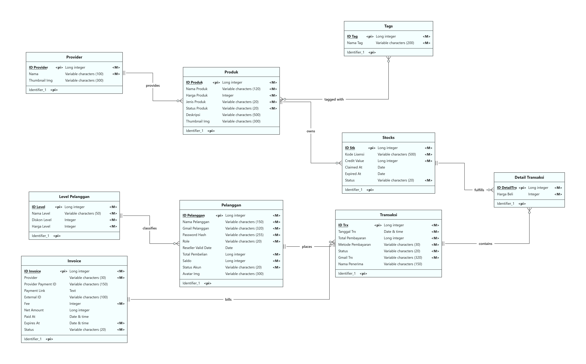

# Z-Store (Porting JSP dan Servlet)

Aplikasi toko lisensi perangkat lunak digital berbasis Java Server Pages (JSP) dan Servlet yang diporting dari proyek `Website-Toko` untuk tugas mata kuliah **EF234301 Pemrograman Web (D) - Quiz 2**.

> Proyek asal `Website-Toko` dikembangkan menggunakan Go (Gin, GORM, dan PostgreSQL). Pada repositori ini, seluruh antarmuka katalog, skema basis data, alur transaksi, serta operasi Create, Read, Update, dan Delete (CRUD) diimplementasikan ulang menggunakan Java 17, JSP/JSTL, Servlet 3.1, JDBC, MySQL/TiDB Cloud, pembayaran QRIS Sumopod, serta penyimpanan gambar pada Neon Object Storage (S3).

---

## 1. Pembagian Tugas Anggota Kelompok

| Nama Anggota | NRP | Persentase | Kontribusi |
| :--- | :--- | :--- | :--- |
| Muhammad Brahmana Priambudi | 5025251129 | 34% | BackEnd |
| Budiman Setiono | 5025251128 | 33% | FrontEnd |
| Muhammad Azka Asyrafany | 5025251131 | 33% | Checking & Reporting |

---

## 2. Perancangan Basis Data

### 2.1 Conceptual Data Model (CDM)

- **Provider** mengelompokkan entitas **Produk** ke dalam kategori (Windows, Microsoft Office, Antivirus, Tool Software, CorelDraw, Adobe, Game, dan VPN).
- **Level_Pelanggan** menentukan tingkat keanggotaan (`Standar` 0%, `Reseller` 10%, `VIP` 20%) yang dimiliki setiap **Pelanggan** (pelanggan maupun admin).
- **Pelanggan** menyimpan informasi akun, peran, total pembelian, serta path/URL foto profil (`Avatar_Img`).
- **Produk** dapat memiliki banyak **Tags** melalui tabel penghubung **Product_Tags**.
- **Stocks** menyimpan masing-masing kode lisensi milik sebuah **Produk** dengan status `Tersedia` atau `Terjual`.
- **Transaksi** mencatat pembelian (baik tamu maupun **Pelanggan** terdaftar), berelasi 1-ke-1 dengan **Invoice** (berdasarkan `External_ID` sebagai Order ID), dan memiliki satu atau lebih **Detail_Transaksi** yang merujuk ke baris **Stocks** yang diklaim.



### 2.2 Physical Data Model (PDM)


Berkas sumber diagram dalam format DDR (Entity Relationship Diagram, Conceptual Data Model, Physical Data Model, dan Arsitektur Sistem) tersedia pada direktori `diagrams/`.

---

## 3. Daftar Fitur yang Diimplementasikan (CRUD)

| No | Fitur | Operasi | Halaman / Endpoint | Deskripsi |
| :--- | :--- | :--- | :--- | :--- |
| 1 | Katalog Produk, Filter, dan Pencarian | Read | `/home` (`index.jsp`) | Menampilkan 98 produk awal, filter berdasarkan kategori, filter multi-tag secara bersamaan, serta pencarian berdasarkan nama produk, kategori, atau tag yang dipisahkan koma. |
| 2 | Detail Produk dan Cek Stok | Read | `/product` (`product.jsp`) | Menampilkan deskripsi produk, daftar tag, harga, jumlah terjual, dan jumlah stok lisensi yang tersedia. |
| 3 | Registrasi Pelanggan | Create | `/register` (`register.jsp`) | Mendaftarkan akun pelanggan baru dengan password yang di-hash menggunakan PBKDF2-HMAC-SHA256. |
| 4 | Login Pelanggan dan Admin | Read | `/login` (`login.jsp`) | Memverifikasi kredensial pengguna dan menyimpan data sesi pengguna pada HTTP session. |
| 5 | Pembaruan Profil dan Foto Profil | Update | `/dashboard` (`dashboard.jsp`) | Pengguna yang masuk dapat mengubah nama tampilan, password, serta mengunggah atau menghapus foto profil (disimpan di Neon S3). |
| 6 | Checkout dan Pembuatan Pesanan (QRIS) | Create | `/checkout` (`checkout.jsp`) | Membuat `Invoice`, `Transaksi`, `Detail_Transaksi`, mengklaim `Stocks` secara atomik, menerapkan diskon level akun, dan membuat tagihan QRIS melalui Sumopod. |
| 7 | Cek Invoice dengan Order ID | Read, Update | `/invoice` (`invoice.jsp`) | Mencari invoice menggunakan Order ID (`External_ID`, contoh `ZST-XXXXXXXX`), memantau status pembayaran, mengonfirmasi pembayaran untuk membuka kode lisensi, dan mencetak bukti transaksi. |
| 8 | Pembatalan Pesanan | Delete | `/invoice`, `/dashboard` | Membatalkan pesanan berstatus `Unpaid` dan mengembalikan stok yang dipesan ke status `Tersedia`. |
| 9 | Kelola Produk dan Unggah Gambar | Create, Read, Update, Delete | `/admin?tab=products` (`admin.jsp`) | Menambah, mengubah (termasuk unggah gambar ke Neon S3 dan pengisian tag dipisahkan koma), melihat daftar, dan menghapus produk. |
| 10 | Kelola Kategori / Provider | Create, Read, Update, Delete | `/admin?tab=providers` (`admin.jsp`) | Menambah, mengubah (termasuk unggah gambar ke Neon S3), melihat daftar, dan menghapus kategori produk. |
| 11 | Kelola Stok Lisensi | Create, Read, Update, Delete | `/admin?tab=stocks` (`admin.jsp`) | Memfilter stok per produk, menambahkan kode lisensi secara massal (batch), mengubah kode/status/masa berlaku, dan menghapus stok yang belum terjual. |
| 12 | Kelola Tags | Create, Read, Update, Delete | `/admin?tab=tags` (`admin.jsp`) | Menambah tag (satuan atau dipisahkan koma), mengubah nama tag, melihat jumlah pemakaian pada produk, dan menghapus tag. |
| 13 | Kelola Pelanggan dan Transaksi | Read, Update, Delete | `/admin?tab=customers`, `/admin?tab=transactions` | Mengubah level dan status pelanggan, menghapus akun non-admin, mengubah status transaksi beserta sinkronisasi invoice dan stok, serta menghapus transaksi. |

---

## 4. Struktur Proyek

```text
quiz-3-webpro/
├── Dockerfile                              # Build multi-stage Maven + Tomcat 9 untuk deployment Render
├── .dockerignore                           # Mengecualikan berkas lokal, kredensial, dan PDF dari build Docker
├── .env.example                            # Contoh variabel lingkungan untuk basis data, Sumopod, dan Neon S3
├── render.yaml                             # Konfigurasi layanan web Render (Docker + /health)
├── build.ps1                               # Skrip kompilasi Java dengan javac dan pembuatan target/zstore.war
├── pom.xml                                 # Konfigurasi Maven WAR (Java 17, Servlet 3.1, JSTL 1.2, MySQL)
├── diagrams/
│   ├── erd.ddr                             # Chen ERD dalam sintaks DDR
│   ├── cdm.ddr                             # Conceptual Data Model dalam sintaks DDR
│   ├── pdm.ddr                             # Physical Data Model dalam sintaks DDR
│   └── architecture.ddr                    # Diagram arsitektur sistem dalam sintaks DDR
├── sql/
│   ├── schema.sql                          # Definisi tabel MySQL (zstore_jsp)
│   └── seed.sql                            # Data awal cadangan: 8 provider, 3 level, 2 akun demo, 98 produk, 10 tag, 296 stok
└── src/main/
    ├── java/com/zstore/
    │   ├── config/                         # EnvLoader, DBConnection, PaymentConfig, S3Config
    │   ├── payment/                        # SumopodClient (klien API QRIS dan parser webhook)
    │   ├── storage/                        # S3Client (klien AWS SigV4 untuk Neon Object Storage)
    │   ├── util/                           # PasswordUtil (PBKDF2), FormatUtil
    │   ├── model/                          # JavaBeans yang merepresentasikan entitas basis data
    │   ├── dao/                            # Kelas DAO JDBC dengan PreparedStatement
    │   └── servlet/                        # Controller MVC, SumopodWebhookServlet, PaymentExpiryListener, HealthServlet
    ├── resources/
    │   ├── db.properties                   # Konfigurasi default MySQL lokal
    │   └── payment.properties              # Pengaturan default Sumopod sandbox dan mode debug
    └── webapp/
        ├── index.jsp                       # Meneruskan permintaan halaman awal ke /home
        ├── static/                         # CSS (zstore.css) serta cadangan gambar lokal produk dan kategori
        └── WEB-INF/
            ├── web.xml                     # Pemetaan servlet, multipart-config, listener, filter UTF-8, halaman 404
            ├── lib/                        # mysql-connector-j-8.0.33.jar, gson-2.10.1.jar, taglibs-standard 1.2.5
            └── views/                      # Halaman JSP dan fragmen header.jspf / footer.jspf
```

---

## 5. Cara Membangun dan Menjalankan Secara Lokal (XAMPP)

### Prasyarat
- Java 17 JDK (`javac`, `jar`)
- XAMPP dengan **MySQL / MariaDB** dan **Apache Tomcat 8.5**

### Langkah 1: Menyiapkan Basis Data
1. Jalankan layanan MySQL melalui XAMPP Control Panel (port default `3306`, user `root`, password kosong), atau gunakan basis data cloud seperti TiDB Cloud Serverless.
2. Untuk instalasi lokal, impor skema dan data awal:
   ```powershell
   & "D:\Program Files\xampp\mysql\bin\mysql.exe" -u root --default-character-set=utf8mb4 -e "source d:/Projects/Webs/quiz-3-webpro/sql/schema.sql; source d:/Projects/Webs/quiz-3-webpro/sql/seed.sql;"
   ```
3. Salin `.env.example` menjadi `.env` (file `.env` diabaikan oleh Git) lalu sesuaikan nilai `DB_HOST`, `DB_PORT`, `DB_NAME`, `DB_USER`, `DB_PASSWORD`, `DB_SSL`, kredensial `SUMOPOD_*`, serta kredensial Neon Object Storage (`AWS_ENDPOINT_URL_S3`, `AWS_ACCESS_KEY_ID`, `AWS_SECRET_ACCESS_KEY`, `AWS_REGION`, `AWS_S3_BUCKET`).

### Langkah 1b: Konfigurasi Pembayaran Sumopod Sandbox (Opsional)
1. Isi variabel `SUMOPOD_BASE_URL`, `SUMOPOD_API_KEY`, dan `SUMOPOD_WEBHOOK_TOKEN` pada `.env` atau pada `src/main/resources/payment.local.properties` (tidak masuk ke Git).
2. Pada Dashboard Sumopod (`Managed Payment -> Settings`), nonaktifkan opsi **"Charge fee to customer"**, arahkan base URL sandbox ke `https://api-pay-sandbox.sumopod.com`, dan atur webhook URL ke `https://<domain-publik>/zstore/webhooks/sumopod`.
3. Jika `PAYMENT_DEBUG_MODE=true`, halaman invoice menampilkan tombol simulasi webhook lokal (`PAID`, `FAILED`, `EXPIRED`) untuk pengujian tanpa memerlukan tunnel publik.

### Langkah 2: Membangun Berkas WAR
Jalankan skrip build berikut (tidak memerlukan instalasi Maven):
```powershell
powershell -ExecutionPolicy Bypass -File .\build.ps1
```
Atau gunakan Maven apabila sudah terpasang:
```bash
mvn clean package
```
Perintah di atas menghasilkan berkas `target/zstore.war`.

### Langkah 3: Deploy ke Tomcat
1. Salin `target/zstore.war` ke `D:\Program Files\xampp\tomcat\webapps\zstore.war`.
2. Jika menggunakan berkas `.env` lokal, salin `.env` ke `D:\Program Files\xampp\tomcat\.env` agar dapat dibaca oleh `EnvLoader`.
3. Jalankan Tomcat dari XAMPP Control Panel, lalu buka browser pada alamat:
   `http://localhost:8080/zstore/`

### Akun Demo
- **Admin:** `admin@zstore.id` / `admin123`
- **Pelanggan (Reseller, diskon 10%):** `budi@zstore.id` / `customer123`

---

## 6. Deployment ke Render (Docker, Cloud MySQL, dan Neon S3)

1. **Siapkan Basis Data MySQL Cloud** (misalnya TiDB Cloud Serverless) lalu impor definisi tabel dari `sql/schema.sql` dan data awal dari `sql/seed.sql`.
   *(Jika penyedia basis data menetapkan nama database tetap tanpa izin `CREATE DATABASE`, lewati baris `CREATE DATABASE` dan `USE`, lalu jalankan sisa query langsung pada database tujuan.)*
2. **Deploy Web Service di Render:**
   - Unggah repositori ke GitHub (berkas sensitif seperti `.env`, `payment.local.properties`, `*.pem`, dan `task.pdf` telah dikecualikan melalui `.gitignore`).
   - Pada dashboard Render, pilih **New + -> Web Service** (atau gunakan Blueprint `render.yaml`), pilih repositori ini, dan gunakan **Runtime: Docker**.
   - Atur Environment Variables berikut pada Render:
     - `DB_HOST`, `DB_PORT`, `DB_NAME`, `DB_USER`, `DB_PASSWORD`, `DB_SSL=true` (atau `DB_URL`)
     - `SUMOPOD_BASE_URL` (`https://api-pay-sandbox.sumopod.com`)
     - `SUMOPOD_API_KEY`
     - `SUMOPOD_WEBHOOK_TOKEN`
     - `PAYMENT_DEBUG_MODE` (`true`)
     - `AWS_ENDPOINT_URL_S3`
     - `AWS_ACCESS_KEY_ID`
     - `AWS_SECRET_ACCESS_KEY`
     - `AWS_REGION` (`ap-southeast-1`)
     - `AWS_S3_BUCKET` (`zapstore`)
3. **Sesuaikan Webhook URL Sumopod:**
   - Karena `Dockerfile` menaruh aplikasi sebagai `ROOT.war`, alamat webhook pada Render adalah:
     `https://<nama-layanan>.onrender.com/webhooks/sumopod`

### 6.1 CI/CD Deployment ke VPS (GitHub Actions, Docker Compose, dan Auto-HTTPS Caddy)
Repositori ini dilengkapi workflow GitHub Actions pada `.github/workflows/deploy.yml` yang otomatis membangun `target/zstore.war` dengan Maven setiap ada push ke branch `main` (atau secara manual via `workflow_dispatch`), lalu mengunggahnya ke `~/projek` pada VPS dan menjalankan `deploy/deploy.sh` bersama `docker-compose.yml` dan `deploy/Caddyfile`.

Layanan Caddy bertindak sebagai reverse proxy pada port `80` dan `443` dengan sertifikat TLS otomatis dari Let's Encrypt (menggunakan variabel `APP_DOMAIN`, default `20-189-75-210.sslip.io`), kompresi `zstd` dan `gzip`, caching aset statis, serta header keamanan HTTP.

Secrets GitHub Actions yang dibutuhkan:
- `VPS_HOST`: alamat IP atau domain VPS
- `VPS_USER`: username SSH VPS
- `VPS_PORT`: port SSH (default `22`)
- `VPS_SSH_KEY`: isi private key SSH (`.pem`)

Berkas `~/projek/.env` dikelola langsung pada VPS dengan izin `chmod 600` dan tidak ikut disimpan di repositori.

---

## 7. Ringkasan Perubahan dari Proyek Asal `Website-Toko`

1. Mengganti handler Go (`gin`, `gorm`) dan query PostgreSQL menjadi Java Servlet, kelas DAO berbasis JDBC, dan query MySQL/TiDB.
2. Mengganti `html/template` Go menjadi tampilan JSP dan JSTL di bawah `WEB-INF/views/` dengan fragmen bersama `header.jspf` dan `footer.jspf`.
3. Menyatukan gaya antarmuka pada seluruh halaman melalui tema gelap pada `static/css/zstore.css`.
4. Mengimplementasikan alur checkout QRIS Sumopod secara transaksional beserta pencarian invoice menggunakan Order ID (`External_ID`), konfirmasi pembayaran, webhook, dan pembatalan otomatis pesanan kedaluwarsa.
5. Menambahkan penyimpanan gambar berbasis Neon Object Storage (S3) untuk produk, kategori/provider, dan foto profil pelanggan, dengan tetap menyimpan aset awal lokal sebagai cadangan.
6. Menambahkan Panel Admin (`/admin`) dan Dashboard Pelanggan (`/dashboard`) untuk pengelolaan lengkap CRUD termasuk edit tag, input tag dipisahkan koma, filter multi-tag, dan sinkronisasi status transaksi.
7. Memperbaiki referensi ID produk pada `Product_Tags` dan `Stocks` dari data awal sehingga seluruh 98 produk memiliki tag dan stok lisensi yang valid.
