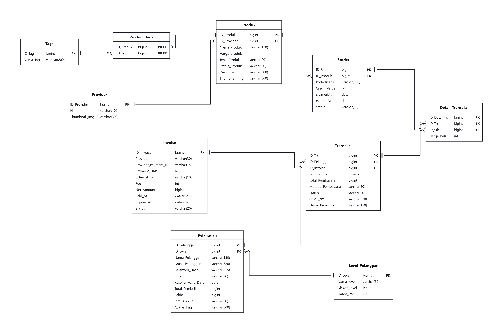

# Z-Store (JSP Port)

A Java Server Pages (JSP) and Servlet port of `Website-Toko`, an online digital license key store, built for **EF234301 Web Programming (D) - Quiz 2**.

> Originally implemented in Go (Gin + GORM + PostgreSQL), this version ports the storefront, database schema, visual styling, and store workflows to Java 17, JSP/JSTL, Servlets, and MySQL/MariaDB, and adds full Create, Read, Update, and Delete (CRUD) features across the store entities.

---

## 1. Course & Submission Checklist  

### Work Distribution (Template for Report)

| Member Name | Student ID | Percentage | Contribution |
| :--- | :--- | :--- | :--- |
| Muhammad Brahmana Priambudi | 5025251129 | 34% | BackEnd |
| Budiman Setiono | 5025251128 | 33% | FrontEnd |
| Muhammad Azka Asyrafany | 5025251131 | 33% | Checking & Reporting |

---

## 2. Database Design

### 2.1 Conceptual Data Model

- **Provider** groups digital **Produk** items into categories (Windows, Microsoft Office, Antivirus, Tool Software, CorelDraw, Adobe, Game, VPN).
- **Level_Pelanggan** defines membership tiers (`Standar` 0%, `Reseller` 10%, `VIP` 20%) assigned to each **Pelanggan** (customer or admin).
- **Produk** can have multiple **Tags** through the **Product_Tags** junction table.
- **Stocks** stores individual license keys belonging to a **Produk** (`Tersedia` or `Terjual`).
- **Transaksi** records each purchase (guest or registered **Pelanggan**), links 1-to-1 to an **Invoice**, and contains one or more **Detail_Transaksi** rows referencing the claimed **Stocks** items.


### 2.2 Physical Data Model



---

## 3. List of Implemented Features (CRUD)

| No | Feature | Operation | Page / Endpoint | Description |
| :--- | :--- | :--- | :--- | :--- |
| 1 | Product Catalog, Filter & Search | Read | `/home` (`index.jsp`) | Browse 98 seeded products, filter by provider or tag, and search by keyword. |
| 2 | Product Detail & Stock Check | Read | `/product` (`product.jsp`) | View product description, tags, price, sold count, and available stock count. |
| 3 | Customer Registration | Create | `/register` (`register.jsp`) | Register a new customer account with PBKDF2-HMAC-SHA256 hashed password. |
| 4 | Customer & Admin Login | Read | `/login` (`login.jsp`) | Authenticate credentials and store the user object in an HTTP session. |
| 5 | Customer Profile Update | Update | `/dashboard` (`dashboard.jsp`) | Logged-in customers can update their display name and password. |
| 6 | Customer Balance Top-Up | Update | `/dashboard` (`dashboard.jsp`) | Customers can add funds to their account `Saldo` for instant checkout. |
| 7 | Checkout & Order Creation | Create | `/checkout` (`checkout.jsp`) | Atomically creates `Invoice`, `Transaksi`, `Detail_Transaksi`, claims `Stocks`, applies level discount, and deducts `Saldo` when paying by balance. |
| 8 | Invoice Lookup & Payment Confirmation | Read, Update | `/invoice` (`invoice.jsp`) | Look up an invoice by ID, confirm `Unpaid` orders to reveal license keys, or print the receipt. |
| 9 | Order Cancellation | Delete | `/invoice`, `/dashboard` | Cancel an `Unpaid` order and release its claimed `Stocks` back to `Tersedia`. |
| 10 | Manage Products | Create, Read, Update, Delete | `/admin?tab=products` (`admin.jsp`) | Add, edit (including tag assignments), list, and delete store products. |
| 11 | Manage Providers / Categories | Create, Read, Update, Delete | `/admin?tab=providers` (`admin.jsp`) | Add, edit, list, and delete product categories. |
| 12 | Manage License Stocks | Create, Read, Update, Delete | `/admin?tab=stocks` (`admin.jsp`) | Filter stock by product, batch-import license keys, edit key/status/expiry, and delete unsold keys. |
| 13 | Manage Tags | Create, Read, Delete | `/admin?tab=tags` (`admin.jsp`) | Add, view usage count, and delete product tags. |
| 14 | Manage Customers & Transactions | Read, Update, Delete | `/admin?tab=customers`, `/admin?tab=transactions` | Update customer level/balance/status, delete non-admin accounts, update transaction status, and delete transactions. |

---

## 4. Project Structure

```text
quiz-3-webpro/
├── Dockerfile                              # Multi-stage Maven + Tomcat 9 build for Render
├── .dockerignore                           # Excludes local classes, secrets, and PDFs from Docker build
├── render.yaml                             # Render Web Service blueprint (Docker + /health)
├── build.ps1                               # Compiles Java sources with javac and packages target/zstore.war
├── pom.xml                                 # Maven WAR configuration (Java 17, Servlet 3.1, JSTL 1.2, MySQL)
├── diagrams/
│   ├── erd.ddr                             # Chen ERD in DDR syntax
│   ├── cdm.ddr                             # Conceptual Data Model in DDR syntax
│   ├── pdm.ddr                             # Physical Data Model in DDR syntax
│   └── architecture.ddr                    # System architecture graph in DDR syntax
├── sql/
│   ├── schema.sql                          # MySQL table definitions (zstore_jsp)
│   └── seed.sql                            # 8 providers, 3 levels, 2 demo accounts, 98 products, 10 tags, 296 stocks
└── src/main/
    ├── java/com/zstore/
    │   ├── config/                         # DBConnection.java, PaymentConfig.java
    │   ├── payment/                        # SumopodClient.java (QRIS client and webhook parser)
    │   ├── util/                           # PasswordUtil (PBKDF2), FormatUtil
    │   ├── model/                          # JavaBeans matching the 9 database entities
    │   ├── dao/                            # PreparedStatement DAOs (Provider, Produk, Tag, Stock, Pelanggan, Transaksi)
    │   └── servlet/                        # MVC Controllers, SumopodWebhookServlet, PaymentExpiryListener, HealthServlet
    ├── resources/
    │   ├── db.properties                   # Default local MySQL configuration
    │   └── payment.properties              # Sumopod sandbox and debug mode settings
    └── webapp/
        ├── index.jsp                       # Forwards welcome request to /home
        ├── static/                         # CSS (zstore.css) and product/provider WebP images
        └── WEB-INF/
            ├── web.xml                     # Servlet mappings, listener, UTF-8 encoding filter, 404 handler
            ├── lib/                        # mysql-connector-j-8.0.33.jar, gson-2.10.1.jar, taglibs-standard 1.2.5
            └── views/                      # JSP views and shared header.jspf / footer.jspf fragments
```

---

## 5. How to Build and Run Locally (XAMPP)

### Prerequisites
- Java 17 JDK (`javac`, `jar`)
- XAMPP with **MySQL / MariaDB** and **Apache Tomcat 8.5**

### Step 1: Initialize the Database
1. Start MySQL from the XAMPP Control Panel (default port `3306`, user `root`, empty password).
2. Import the schema and seed data:
   ```powershell
   & "D:\Program Files\xampp\mysql\bin\mysql.exe" -u root --default-character-set=utf8mb4 -e "source d:/Projects/Webs/quiz-3-webpro/sql/schema.sql; source d:/Projects/Webs/quiz-3-webpro/sql/seed.sql;"
   ```
   *(If your MySQL credentials differ, update `src/main/resources/db.properties` or set `DB_HOST`, `DB_PORT`, `DB_NAME`, `DB_USER`, `DB_PASSWORD` environment variables.)*

### Step 1b: Configure Sumopod Sandbox Payment (Optional, for Live QRIS Testing)
1. Copy `src/main/resources/payment.properties` to `src/main/resources/payment.local.properties` (gitignored), or set environment variables `SUMOPOD_BASE_URL`, `SUMOPOD_API_KEY`, and `SUMOPOD_WEBHOOK_TOKEN`.
2. In your Sumopod Dashboard (`Managed Payment -> Settings`), keep **"Charge fee to customer"** OFF, set the sandbox base URL to `https://api-pay-sandbox.sumopod.com`, and point the webhook URL to `https://<your-public-url>/zstore/webhooks/sumopod`.
3. When `payment.debug_mode=true` (default), the invoice page also shows local webhook simulation buttons (`PAID`, `FAILED`, `EXPIRED`) for offline testing without a public tunnel.

### Step 2: Build the WAR Archive
Run the build script (does not require Maven):
```powershell
powershell -ExecutionPolicy Bypass -File .\build.ps1
```
Or build with Maven if installed:
```bash
mvn clean package
```
This produces `target/zstore.war`.

### Step 3: Deploy to Tomcat
1. Copy `target/zstore.war` into `D:\Program Files\xampp\tomcat\webapps\zstore.war`.
2. Start Tomcat from the XAMPP Control Panel.
3. Open your browser and visit:
   `http://localhost:8080/zstore/`

### Demo Accounts
- **Admin:** `admin@zstore.id` / `admin123`
- **Customer (Reseller, 10% discount):** `budi@zstore.id` / `customer123`

---

## 6. Deploy to Render (Docker + Cloud MySQL)

1. **Create a Cloud MySQL Database** (for example TiDB Cloud Serverless or Aiven free tier) and import the `CREATE TABLE` statements from `sql/schema.sql` and data inserts from `sql/seed.sql`.
   *(If your database provider gives a fixed database name such as `defaultdb` or `test` without `CREATE DATABASE` permission, skip the `CREATE DATABASE` and `USE` lines and run the remaining SQL directly in your target database.)*
2. **Deploy Web Service on Render:**
   - Push this repository to GitHub (`task.pdf` and `payment.local.properties` are excluded via `.gitignore`).
   - In Render, choose **New + -> Web Service** (or Blueprint using `render.yaml`), select this repository, and keep **Runtime: Docker**.
   - Set these Environment Variables in Render:
     - `DB_URL` (or `DB_HOST`, `DB_PORT`, `DB_NAME`, and `DB_SSL=true` if TLS is required)
     - `DB_USER`
     - `DB_PASSWORD`
     - `SUMOPOD_BASE_URL` (`https://api-pay-sandbox.sumopod.com`)
     - `SUMOPOD_API_KEY`
     - `SUMOPOD_WEBHOOK_TOKEN`
     - `PAYMENT_DEBUG_MODE` (`true`)
3. **Update Sumopod Webhook URL:**
   - Because `Dockerfile` deploys the WAR as `ROOT.war`, the webhook endpoint on Render is:
     `https://<your-service>.onrender.com/webhooks/sumopod`

---

## 7. Changes Made from the Original `Website-Toko`

1. Replaced Go (`gin`, `gorm`) handlers and PostgreSQL queries with Java Servlets, JDBC DAOs, and MySQL queries.
2. Replaced Go `html/template` files with JSP + JSTL views under `WEB-INF/views/` sharing common `header.jspf` and `footer.jspf` fragments.
3. Unified the color scheme across all pages using the dark obsidian and violet theme (`static/css/zstore.css`).
4. Implemented a working transactional checkout and invoice confirmation flow instead of the placeholder redirect in the original repository.
5. Added the Admin Panel (`/admin`) and Customer Dashboard controls (`/dashboard`) so all entities support full CRUD operations.
6. Fixed broken product IDs in `Product_Tags` and `Stocks` from the original `seed.sql` so all 98 products have valid tags and available license keys.

